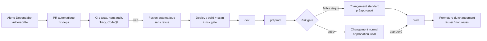

# patch-relay

Service de démonstration qui illustre une chaîne **DevSecOps de remédiation automatisée des vulnérabilités** avec un **changement ServiceNow piloté par le pipeline**.

Le service lui-même est volontairement minimal (une API Express avec `/health` et `/api/inventory`). Ce qui compte, c'est le flux autour : détection, correctif automatique, évaluation du risque, changement ITSM et déploiement multi-environnements.

> La dépendance `express@4.17.1` est volontairement vulnérable pour que Dependabot ouvre une PR de sécurité et déclenche le flux de bout en bout.

## Flux



| Étape | Workflow | Détail |
|---|---|---|
| Détection | `.github/dependabot.yml` | Alertes et mises à jour de sécurité npm + actions |
| Contrôles PR | `ci.yml`, `codeql.yml` | Tests, `npm audit`, Trivy (SCA), CodeQL (SAST) |
| Fusion | `ci.yml` › `auto-merge` | PR Dependabot fusionnée en squash dès que la CI passe, **sans revue** |
| Livraison | `deploy.yml` | dev → préprod → changement ServiceNow → prod |
| Évaluation du risque | `scripts/risk-gate.js` | Règles d'admissibilité au chemin automatisé |
| ITSM | `scripts/servicenow-change.js` | Création, attente d'approbation, Implement, fermeture |

## Règles du risk gate

Une livraison est **admissible au chemin automatisé (faible risque)** si toutes les conditions sont vraies :

1. elle provient de Dependabot ;
2. la mise à jour est de type *patch* ou *minor* ;
3. seuls les manifestes de dépendances sont modifiés (`package.json`, `package-lock.json`) ;
4. l'analyse Trivy ne laisse aucune vulnérabilité résiduelle au-dessus de `MEDIUM`.

Sinon, le risque est `moderate` ou `high` et un changement normal attend l'approbation dans ServiceNow (délai maximal : 60 minutes).

## Configuration ServiceNow

Sans identifiants, tout le flux s'exécute en **mode simulation** (`DRY_RUN`) : les appels à ServiceNow sont journalisés dans les logs et le résumé de chaque exécution.

Pour brancher une instance réelle (*Settings › Secrets and variables › Actions*) :

| Type | Nom | Exemple |
|---|---|---|
| Variable | `SN_INSTANCE` | `dev12345` |
| Secret | `SN_USER` | compte d'intégration avec le rôle `sn_change_write` / `itil` |
| Secret | `SN_PASSWORD` | — |
| Variable (optionnelle) | `SN_STD_TEMPLATE_ID` | sys_id du modèle de changement standard « Correctif de dépendance — faible risque » (`std_change_record_producer`) |
| Variable (optionnelle) | `SN_CMDB_CI` | sys_id du CI applicatif |
| Variable (optionnelle) | `SN_ASSIGNMENT_GROUP` | sys_id du groupe d'affectation |

API utilisées :

- `POST /api/sn_chg_rest/change/standard/{template}` : changement standard préapprouvé ;
- `POST /api/sn_chg_rest/change/normal` : changement normal ;
- `GET|PATCH /api/now/table/change_request/{sys_id}` : suivi de l'approbation et transitions d'état.

Traçabilité : chaque changement porte `correlation_id = <repo>#<run_id>` et le lien vers l'exécution GitHub Actions.

## Développement local

```bash
npm ci
npm test
npm start                      # http://localhost:3000/health
ORIGIN=dependabot UPDATE_TYPE=version-update:semver-patch \
  CHANGED_FILES=package.json npm run risk-gate
ELIGIBLE=true RISK=low npm run change -- create   # mode simulation
```

## Limites connues (volontaires pour le POC)

- Aucune revue humaine sur les PR Dependabot : la CI et le risk gate sont les seuls contrôles.
- Les déploiements sont simulés (démarrage du service + sonde `/health` sur le runner).
- Le retour arrière est documenté dans le changement, mais il n'est pas automatisé.
